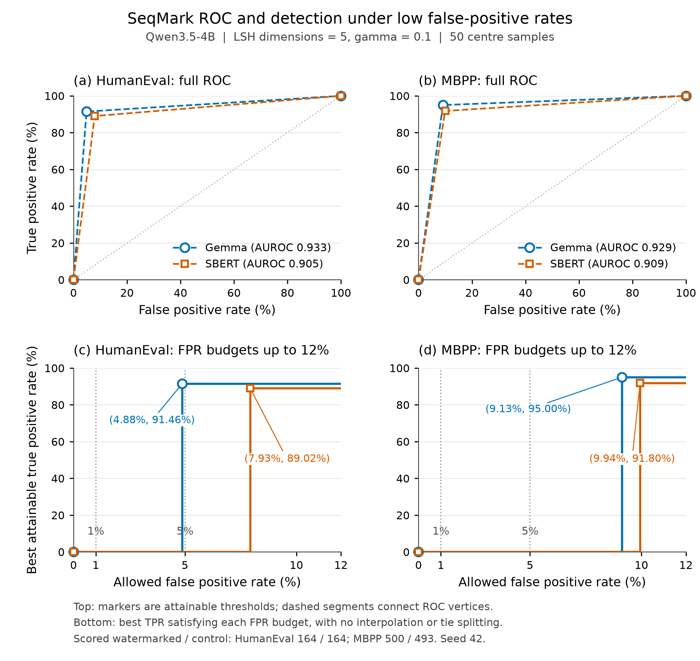
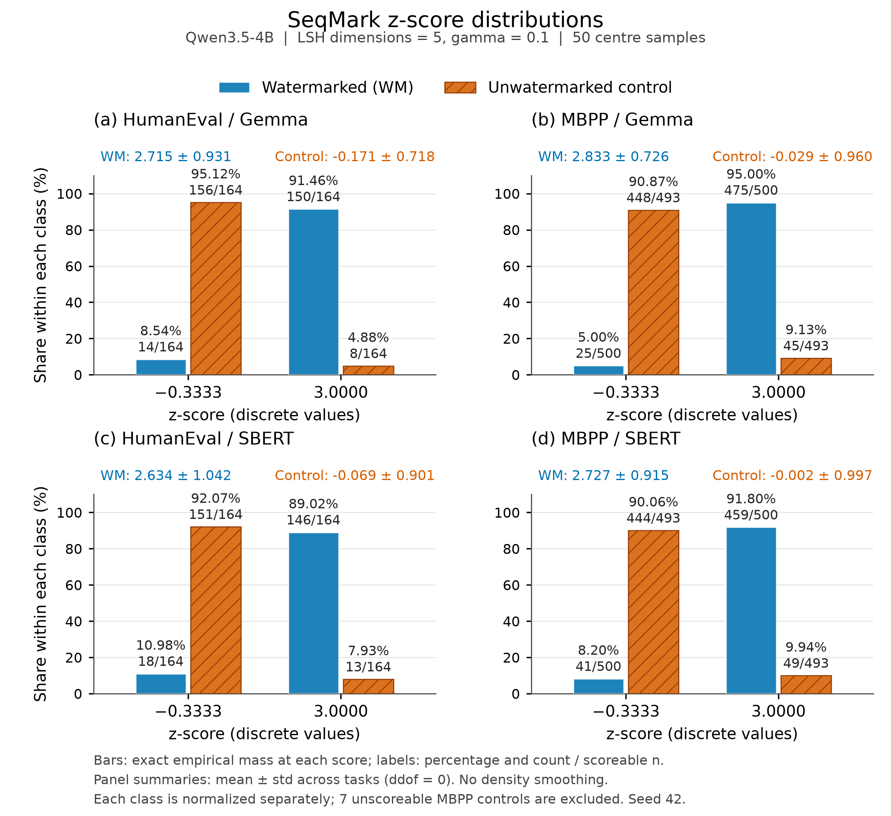

# Watermarking baseline benchmark results

Model: Qwen3.5-4B (`Qwen/Qwen3.5-4B`), sampling T=0.7 / top_p=0.8 / top_k=20
except for SeqMark, whose parameters are specified below;
seed 42, `enable_thinking=False`. Benchmarks: HumanEval (164), MBPP (500),
LiveCodeBench (400). Methods: KGW (pilot + official impls), SWEET (port),
SemStamp (pilot + official impls), CodeWM (port of ../code-watermark,
Guo & Cheng NeurIPS 2025), and SeqMark (embeddinggemma-300m and SBERT).

The SeqMark comparison covers HumanEval and MBPP. Its LiveCodeBench run was
cancelled at the researcher's request and is excluded from SeqMark Results.
The previous SeqMark runs are superseded; their full values remain in the
[superseded results](#superseded-seqmark-local-runs). The current reproduction
uses the source method, example parameters, and a training-split search for
LSH dimensions and gamma. The common configuration is fixed at LSH dimension 5
and gamma 0.1. All four full benchmark reruns and execution evaluations are
complete.

**Setup for this round** (numbers NOT comparable to `archive/out_round1/`):

- Dataset-level system prompts (`dataloader.<ds>.SYSTEM_PROMPT`), all
  appending the universal no-code-comments rule.
- `MAX_NEW_TOKENS = 2000` for every dataset (the earlier 512/1024 budgets
  truncated ~1/3 of LCB completions before the code block, confounding
  pass@1).
- SemStamp uses the line segmenter for ALL runs, both impls
  (`--segmenter line`, the default); official impl runs `--max-trials 32`.
- SWEET defaults: gamma 0.5 / delta 8 / entropy-threshold 0.5 / z 4
  (delta from this pilot's KGW sweep; the rest upstream).
- KGW delta=8, gamma 0.5, z 4 (official adds lefthash +
  `ignore_repeated_ngrams=True`).
- CodeWM (wm/codewm + run_codewm.py): trained pairwise-rank greenlist with
  a learned entropy switch; detection needs only the small CodeModel, not
  the LLM. Run at delta 2 / switch 0.7 / context 2 (upstream README recipe)
  AND delta 8 (this pilot's KGW-sweep convention); gamma 0.5, z 4. The
  CodeModel (train_codewm.py; checkpoint
  /scratch.global/wu001810/llm_watermark/codewm/codemodel_alpaca_cw2_snap/)
  was distilled from Qwen3.5-4B on its own MBPP-train completions (10 per
  task, splits disjoint from the test 500) + 20k CodeAlpaca sequences —
  3.58M unique 3-gram examples. delta-8 and LCB runs cost 150-230 s/task,
  so those cells are capped (n in the table; `capped` noted in meta).

Recompute detection statistics with `python utils.py summarize-methods` (from `src/`).
The original-method pass@1 columns come from the adjacent evaluator files;
SeqMark summaries additionally validate and read the matching per-task verdicts.

**SeqMark configuration and search.** The implementation in `src/wm/seqmark/`
follows the [released class](https://github.com/nle18/seqmark/blob/3c1ae8f9988e025e3d564839817a15a85bdcf0ff/watermark/correct_watermark.py),
with 50 centre samples as specified in the [paper](https://arxiv.org/html/2601.11629v2).
Detection reuses the saved generation centre for both classes. Each sequence
is encoded separately; all centre samples contribute to the arithmetic mean.
The cached centre is restored as float64, matching the released implementation.

| Parameter | Value | Basis |
|---|---|---|
| Centre samples per prompt | 50 | Paper Section 7.3 and Table 7 |
| Centre, candidate, and control temperature | 1.2 | Released centre example; researcher-specified candidate temperature |
| Repetition penalty | 1.05 | Released generation classes |
| Top-k / top-p | Disabled / 1.0 | Unrestricted sampling; released example disables top-k |
| Maximum rejection trials | 50 | Released WMT19 example |
| Secret hash key | 12345 | Released WMT19 example |
| Candidate selection | First accepted candidate; otherwise last of 50 | Released class |
| LSH dimensions | 5 | Selected from 2, 3, 4, 5 in the training search |
| Gamma | 0.1 | Selected from 0.1, 0.25, 0.5, 0.75 in the training search |
| Number of green regions | 3 of 32 | Released integer truncation of gamma times 2 to the LSH dimension |
| Program generation budget | 2000 tokens | Existing code benchmark protocol |
| Random seed | 42 | Existing benchmark convention |

The search uses 100 MBPP training tasks sampled with `random.Random(42)` from
[official training IDs 601–974](https://github.com/google-research/google-research/blob/master/mbpp/README.md).
The selected IDs and source fingerprint are in
[the data provenance](seqmark/sweep/data_provenance.json). Their IDs and exact
prompt texts are disjoint from the 500 MBPP test tasks. HumanEval is not used
for parameter selection. The search maximizes the mean detection F1 of Gemma
and SBERT. For each encoder, the threshold follows the released classifier's
maximum true-positive-rate / false-positive-rate rule, skipping zero false
positive rates. Ties between configurations are resolved by mean AUROC, fewer
mean rejection trials, smaller LSH dimension, then smaller gamma. The selected
LSH dimension and gamma are shared across both encoders and both benchmarks.

For every search task, both encoders and all 16 configurations use the same 50
centre-sampling texts, 50 ordered candidate texts, and paired unwatermarked
completion. Candidate requests have independent seeds and are scheduled in
batches; selection preserves their fixed order. All texts and per-configuration
selections are saved. Full test runs generate fresh outputs after selection;
SBERT reuses Gemma's exact centre-sampling texts and unwatermarked controls,
and regenerates candidates with the same sampling parameters and seeds.

Gemma uses `google/embeddinggemma-300m` revision
`57c266a740f537b4dc058e1b0cda161fd15afa75`, its native SentenceTransformer
pipeline, float32, and a 2048-token encoder limit. SBERT uses
`AbeHou/SemStamp-c4-sbert` revision `a77dce8530e100ac1101981e4be390546c1cb282`,
the same Transformer and mean-pooling pipeline as the existing SemStamp
methods, float32, and a 512-token limit. The encoder comparison includes
native tokenization, pooling, and truncation. Generation uses vLLM in
bfloat16 on aga14 A100; vLLM does not guarantee identical generated bytes
across executions with the same seed.

This is the SeqMark source method under the repository's Qwen3.5-4B,
complete-program protocol. The paper used CodeLlama for MBPP and did not report
HumanEval. Its final MBPP configuration is absent from the released repository;
the researcher authorized example defaults and this local search. The released
WMT19 class's first-sentence extraction, newline ban, and hardcoded 50-token
budget are replaced by the existing complete-program extraction and 2000-token
budget. An unextractable centre sample contributes an empty-string embedding;
execution tests never select centre samples or watermarked candidates.

Operational checks verified all 16 parameter combinations against sequential
first-accepted selection and cached-centre detection on fixed replay inputs,
and matched the released classifier on boundary cases. These are correctness
checks, separate from benchmark measurements. Run manifests, resolved
arguments, source snapshots, and per-task evidence are retained under
`out/seqmark/`. The search and all four full benchmark evaluations are complete.
The primary Results table contains both encoders on all 164 HumanEval tasks
and all 500 MBPP test tasks.

**SeqMark parameter search on MBPP training data.** The following values use
100 paired training tasks and are excluded from the benchmark Results table.
The selected configuration maximizes the mean F1 across encoders; it need not
maximize each encoder separately. The complete selection record, thresholds,
and source-run references are in [selected_config.json](seqmark/sweep/selected_config.json).

| LSH dimensions | Gamma | Green regions | Gemma F1 | SBERT F1 | Mean F1 | Gemma AUROC | SBERT AUROC | Mean trials |
|---|---|---|---|---|---|---|---|---|
| 2 | 0.1 | 0 | 66.44% | 66.44% | 66.44% | 0.500 | 0.500 | 50.00 |
| 2 | 0.25 | 1 | 88.11% | 91.32% | 89.71% | 0.864 | 0.904 | 4.71 |
| 2 | 0.5 | 2 | 77.52% | 80.97% | 79.25% | 0.707 | 0.763 | 2.19 |
| 2 | 0.75 | 3 | 72.73% | 74.35% | 73.54% | 0.621 | 0.652 | 1.35 |
| 3 | 0.1 | 0 | 66.44% | 66.44% | 66.44% | 0.500 | 0.500 | 50.00 |
| 3 | 0.25 | 2 | 89.29% | 90.09% | 89.69% | 0.879 | 0.889 | 5.03 |
| 3 | 0.5 | 4 | 80.00% | 81.30% | 80.65% | 0.747 | 0.768 | 2.26 |
| 3 | 0.75 | 6 | 73.53% | 73.80% | 73.67% | 0.636 | 0.641 | 1.46 |
| 4 | 0.1 | 1 | 93.75% | 85.41% | 89.58% | 0.940 | 0.865 | 22.29 |
| 4 | 0.25 | 4 | 88.50% | 87.22% | 87.86% | 0.869 | 0.854 | 5.27 |
| 4 | 0.5 | 8 | 80.65% | 80.00% | 80.32% | 0.758 | 0.747 | 2.21 |
| 4 | 0.75 | 12 | 71.94% | 71.68% | 71.81% | 0.606 | 0.601 | 1.41 |
| **5** | **0.1** | **3** | **92.61%** | **91.35%** | **91.98%** | **0.925** | **0.909** | **14.80** |
| 5 | 0.25 | 8 | 87.34% | 89.69% | 88.51% | 0.854 | 0.884 | 4.96 |
| 5 | 0.5 | 16 | 81.63% | 82.30% | 81.97% | 0.773 | 0.783 | 2.33 |
| 5 | 0.75 | 24 | 73.80% | 74.07% | 73.94% | 0.641 | 0.646 | 1.48 |

Each encoder has 100 scoreable watermarked outputs for configurations with
nonempty green regions, 98 for the two zero-region configurations, and 99
scoreable unwatermarked controls. Unscoreable outputs are excluded from these
detection metrics, consistently with the benchmark protocol. For zero-region
configurations, the released threshold rule predicts every scoreable output
as positive; their AUROC is 0.5. Mean trials averages both encoders. The fixed
classification threshold for the selected configuration is the green-region
score, approximately 3.0, for both encoders.

## Results

**Evaluation protocol** (unified across all methods and datasets, 2026-07-25).
Regenerate with `python utils.py summarize-methods` from `src/`.

1. **Detection scores the extracted program**, never the raw completion. A chat
   model wraps code in a markdown fence and adds prose; scoring those non-code
   tokens inflates the green fraction on the watermarked and unwatermarked
   classes alike and crushes their separation. This repo watermarks *code*, so
   non-code text does not count — and a method that scores worse under
   code-only scoring is showing a real limitation, not a measurement artifact.
2. **The negative class is the paired unwatermarked completion** — same model,
   same prompt, watermark off. Not the benchmark's reference solution: a human
   solution differs from model output in length, style and formatting, so
   scoring against it conflates "is watermarked" with "was written by a model"
   and reads systematically higher (measured on CodeWM/deepseek MBPP: AUROC
   0.798 vs human against 0.673 vs the paired baseline).
3. **The headline metric is TPR at fixed FPR from the ROC**, not the
   z>threshold flip rate, which is near-0 by construction on short completions
   however separable the classes are.

For every method, `TPR@k = max TPR(t) over thresholds t with FPR(t) <= k`,
where `k` is 0.01 or 0.05 and a score is positive when `score >= t`.
Thresholds are swept over the unrounded test-set scores. Each rate uses its
own scoreable class as the denominator. Equal scores remain together;
the calculation uses neither ROC interpolation nor randomized tie splitting.
Both the existing methods and SeqMark call the same `detection_summary`,
`_roc_block`, and `tpr_at_fpr` functions in [src/utils.py](../src/utils.py).
The fixed training threshold used for SeqMark's additional precision,
recall, and F1 table does not determine these primary ROC columns.

**pass@1 is deliberately NOT governed by rule 1.** The watermark task is this
project's to define; the benchmark's evaluation is not. `extracted_code` keeps
the benchmark's own extraction and `eval_pass1.py` still reads it, so a change
on the watermark side can never move a quality number. The pass@1 columns below
for the original methods are therefore unchanged from the previous protocol
(verified byte-identical on all 37 rescored files). SeqMark uses the same
benchmark extraction and evaluator.

`scored` = watermarked completions with a non-null detector score;
`unscoreable` = those that did not (no fenced block and not parseable Python).
**Unscoreable samples are excluded from AUROC/TPR, so read those two columns
together** — a high AUROC over a small `scored` subset is not a strong result.

| method | impl | dataset | n | scored | unscoreable | AUROC | TPR@1% | TPR@5% | mean z (wm) | mean z (base) | pass@1 (wm) | pass@1 (base) |
|---|---|---|---|---|---|---|---|---|---|---|---|---|
| KGW | pilot | humaneval | 164 | 147 | 17 (10%) | 0.969 | 91.8% | 93.2% | +30.92 | -0.82 | 0.6% | 76.2% |
| KGW | pilot | mbpp | 500 | 257 | 243 (49%) | 1.000 | 99.6% | 100.0% | +34.15 | -0.90 | 0.2% | 54.4% |
| KGW | pilot | livecodebench | 400 | 287 | 113 (28%) | 0.675 | 41.8% | 52.3% | +8.38 | -0.23 | 1.0% | 43.8% |
| KGW | official | humaneval | 164 | 164 | 0 (0%) | 0.912 | 73.8% | 79.3% | +3.21 | -0.15 | 9.1% | 76.2% |
| KGW | official | mbpp | 500 | 500 | 0 (0%) | 0.991 | 93.8% | 95.6% | +4.51 | -0.13 | 4.2% | 54.4% |
| KGW | official | livecodebench | 400 | 387 | 13 (3%) | 0.996 | 94.1% | 97.4% | +6.86 | -0.73 | 0.8% | 44.3% |
| SWEET | port | humaneval | 164 | 164 | 0 (0%) | 0.765 | 22.6% | 43.3% | +1.88 | +0.44 | 63.4% | 79.3% |
| SWEET | port | mbpp | 500 | 500 | 0 (0%) | 0.828 | 36.2% | 51.6% | +3.23 | +0.51 | 44.8% | 59.2% |
| SWEET | port | livecodebench | 400 | 373 | 27 (7%) | 0.870 | 63.3% | 70.8% | +11.43 | +1.36 | 27.0% | 42.5% |
| SemStamp | pilot | humaneval | 164 | 164 | 0 (0%) | 0.546 | 3.7% | 8.5% | +0.50 | +0.24 | 73.2% | 76.2% |
| SemStamp | pilot | mbpp | 500 | 499 | 0 (0%) | 0.560 | 2.6% | 10.8% | +0.57 | +0.13 | 57.0% | 54.4% |
| SemStamp | pilot | livecodebench | 400 | 386 | 14 (4%) | 0.709 | 28.0% | 38.1% | +3.40 | +0.65 | 43.5% | 43.8% |
| SemStamp | official | humaneval | 164 | 164 | 0 (0%) | 0.545 | 1.2% | 4.9% | +0.54 | +0.35 | 76.2% | 76.2% |
| SemStamp | official | mbpp | 500 | 500 | 0 (0%) | 0.512 | 2.0% | 4.8% | +0.45 | +0.41 | 56.0% | 54.4% |
| SemStamp | official | livecodebench | 400 | 392 | 8 (2%) | 0.651 | 15.6% | 24.7% | +1.87 | +0.76 | 43.8% | 43.8% |
| CodeWM | port (δ=2) | humaneval | 164 | 164 | 0 (0%) | 0.577 | 1.2% | 6.1% | -0.01 | -0.28 | 73.8% | 76.2% |
| CodeWM | port (δ=2) | mbpp | 500 | 500 | 0 (0%) | 0.620 | 4.2% | 11.2% | +0.01 | -0.39 | 55.2% | 56.8% |
| CodeWM | port (δ=2) | livecodebench | 104 | 96 | 8 (8%) | 0.897 | 42.7% | 56.2% | +3.06 | -1.09 | 41.3% | 45.2% |
| CodeWM | port (δ=8) | humaneval | 88 | 88 | 0 (0%) | 0.797 | 15.9% | 39.8% | +3.32 | -0.10 | 50.0% | 84.1% |
| CodeWM | port (δ=8) | mbpp | 96 | 96 | 0 (0%) | 0.889 | 55.2% | 61.5% | +4.28 | -0.35 | 20.8% | 68.8% |
| CodeWM | port (δ=8) | livecodebench | 48 | 45 | 3 (6%) | 0.967 | 75.6% | 88.9% | +12.59 | -1.07 | 10.4% | 47.9% |
| SeqMark | port (embeddinggemma-300m) | humaneval | 164 | 164 | 0 (0%) | 0.933 | 0.0% | 91.5% | +2.72 | -0.17 | 40.9% | 48.8% |
| SeqMark | port (embeddinggemma-300m) | mbpp | 500 | 500 | 0 (0%) | 0.929 | 0.0% | 0.0% | +2.83 | -0.03 | 29.6% | 35.2% |
| SeqMark | port (SBERT) | humaneval | 164 | 164 | 0 (0%) | 0.905 | 0.0% | 0.0% | +2.63 | -0.07 | 39.6% | 48.8% |
| SeqMark | port (SBERT) | mbpp | 500 | 500 | 0 (0%) | 0.909 | 0.0% | 0.0% | +2.73 | -0.00 | 29.2% | 35.2% |

The SemStamp LiveCodeBench control pass@1 values were corrected to 43.8%
from the earlier reported 44.3%. Both stored control cohorts match all 400
KGW pilot completions exactly; their evaluator records 175 passing programs
(43.75%). The [correction record](../results/report_corrections.json) preserves
the earlier values and the evidence hashes. Raw results are unchanged.

<!-- seqmark-classification-start -->
**SeqMark classification at the fixed training threshold.** The threshold is
selected on the 100 MBPP training tasks and held fixed for the test splits.
For all four rows below, it also equals the threshold returned by applying
the released maximum-TPR/FPR rule to the full test scores. Each program is
one sequence; its score is approximately 3.0 in a green region and -0.333
otherwise. Classification uses the stored threshold without rounding.
Unscoreable outputs are excluded from these detection metrics; pass@1 in the
main table retains the full benchmark denominator.

| Encoder | Dataset | Scored watermarked / control | True positives | False positives | Precision | Recall | F1 | FPR |
|---|---|---|---|---|---|---|---|---|
| Gemma | humaneval | 164 / 164 | 150 | 8 | 94.94% | 91.46% | 93.17% | 4.88% |
| Gemma | mbpp | 500 / 493 | 475 | 45 | 91.35% | 95.00% | 93.14% | 9.13% |
| SBERT | humaneval | 164 / 164 | 146 | 13 | 91.82% | 89.02% | 90.40% | 7.93% |
| SBERT | mbpp | 500 / 493 | 459 | 49 | 90.35% | 91.80% | 91.07% | 9.94% |

For Gemma on MBPP, the accepted-score group contains 475/500 watermarked
programs and 45/493 scoreable controls. Its 9.13% false-positive rate exceeds
both headline limits, so a deterministic threshold satisfying either limit
rejects the entire group. For Gemma on HumanEval, 8/164 controls have the
accepted score, giving 4.88% FPR. This permits 91.46% TPR at the 5% limit,
while TPR at the 1% limit remains zero. Tied scores are never split or
interpolated. SBERT's false-positive rates are 7.93% on HumanEval and 9.94%
on MBPP, exceeding both headline limits. Its recall at the fixed training
threshold remains 89.02% and 91.80%, respectively. These per-program metrics
differ from the paper's additional
ROC analysis that aggregates 30 examples per decision in
[Appendix A.2](https://arxiv.org/html/2601.11629v2).

<!-- seqmark-roc-start -->

The figure uses the four full test runs in the primary table. Upper panels
show empirical ROC vertices for Gemma and SBERT; only the marked vertices
are attainable by deterministic thresholds. Dashed connectors show the
conventional ROC representation used for AUROC. Lower panels show the best
TPR satisfying each allowed FPR from 0% to 12%, without interpolation or
splitting tied scores. Vertical dotted lines mark the primary table's 1%
and 5% FPR limits. Each program is one decision, with unscoreable outputs
excluded independently from each class. The figure reports one seed.

[Vector PDF](seqmark/figures/seqmark_roc.pdf),
[ROC vertices and thresholds](seqmark/figures/seqmark_roc_points.csv),
[figure provenance](seqmark/runs/20260915T015302Z_roc/manifest.json), and
[executed plotting source](seqmark/runs/20260915T015302Z_roc/plot_executed.py).
<!-- seqmark-roc-end -->

<!-- seqmark-z-distribution-start -->

The distribution figure uses the same four full test runs. Bars show the
empirical probability mass at each of the two observed z-scores, approximately
-0.3333 and 3.0. Watermarked and unwatermarked classes are normalized
separately; labels give the percentage and count divided by the scoreable
class size. Panel summaries report the mean and standard deviation across
task scores, using a variance denominator of n (`ddof=0`). HumanEval has
164 scoreable outputs per class; MBPP has 500 watermarked outputs and 493
controls after excluding seven unscoreable controls. The figure uses the
exact score frequencies without density smoothing.

[Vector PDF](seqmark/figures/seqmark_z_distribution.pdf),
[counts, probabilities, means, and standard deviations](seqmark/figures/seqmark_z_distribution.csv),
[figure provenance](seqmark/runs/20260915T020154Z_z_distribution/manifest.json), and
[executed plotting source](seqmark/runs/20260915T020154Z_z_distribution/plot_executed.py).
<!-- seqmark-z-distribution-end -->

**Encoder comparison.** Under the shared SeqMark configuration, Gemma has
higher AUROC and F1 than SBERT on both test splits. Replacing Gemma with
SBERT reduces F1 by 2.77 percentage points on HumanEval and 2.07 percentage
points on MBPP. SeqMark with SBERT retains AUROC 0.905 on HumanEval and 0.909
on MBPP, above both existing SemStamp implementations. The observed AUROC
difference therefore cannot be attributed entirely to Gemma. Cross-method
comparisons also change sampling parameters and the sequence unit; this
single-seed comparison does not isolate the contribution of centering.

Execution evaluation counts Python source containing a raw NUL character as
a failed attempt, preserving the original generated text. The evaluator
handles this before subprocess launch so one invalid program cannot abort
the full split. The [evaluator snapshot](seqmark/source_snapshots/1da51e14d30eb34f869936159cd0993a2605241317745f6d0cb5dc77fb03368e/src/eval_pass1.py)
passed an operational check with a valid canonical HumanEval solution and
an invalid NUL-containing program.

SeqMark result provenance and verification

| Encoder | Dataset | Generated outputs | Execution verdict provenance | Completed evaluation |
|---|---|---|---|---|
| Gemma | humaneval | [outputs](seqmark/humaneval/seqmark_humaneval_port_cached_qwen3.5-4b.json) | [provenance](seqmark/humaneval/pass1_seqmark_port_cached_qwen3.5-4b_humaneval.provenance.json) | [manifest](seqmark/runs/20260914T193621Z_fb93ae44/manifest.json) |
| Gemma | mbpp | [outputs](seqmark/mbpp/seqmark_mbpp_port_cached_qwen3.5-4b.json) | [provenance](seqmark/mbpp/pass1_seqmark_port_cached_qwen3.5-4b_mbpp.provenance.json) | [manifest](seqmark/runs/20260914T212625Z_00db2082/manifest.json) |
| SBERT | humaneval | [outputs](seqmark/humaneval/seqmark_humaneval_port_sbert_cached_qwen3.5-4b.json) | [provenance](seqmark/humaneval/pass1_seqmark_port_sbert_cached_qwen3.5-4b_humaneval.provenance.json) | [manifest](seqmark/runs/20260914T214558Z_2b1d6266/manifest.json) |
| SBERT | mbpp | [outputs](seqmark/mbpp/seqmark_mbpp_port_sbert_cached_qwen3.5-4b.json) | [provenance](seqmark/mbpp/pass1_seqmark_port_sbert_cached_qwen3.5-4b_mbpp.provenance.json) | [manifest](seqmark/runs/20260914T225231Z_7f449be4/manifest.json) |

Each output references its four generation shards, generation manifests, and
per-task sampling evidence. The execution provenance binds the verdicts to
the exact generated input and verdict files using SHA256. Gemma HumanEval's
initial merge completed generation but failed during execution evaluation on
invalid NUL-containing source. The completed retry above evaluates that same
immutable input; the failed record remains in the ledger.

The [final verification manifest](seqmark/runs/20260914T225431Z_final_summary/manifest.json),
[full metric values](seqmark/runs/20260914T225431Z_final_summary/metrics.json),
[operational checks](seqmark/runs/20260914T225431Z_final_summary/diagnostics.json),
and [executed verification source](seqmark/runs/20260914T225431Z_final_summary/verify_executed.py)
record the final aggregation. All 1,328 task results passed checks of the
frozen parameters, 50 centre samples, reuse of the generation centre, ordered
first-accepted selection, fallback at 50 trials, and source fingerprints.
There were no differences between generation acceptance and cached-centre
detection. Across the 664 paired tasks, both encoders used identical centre
sampling texts and unwatermarked outputs, and all unwatermarked execution
verdicts matched. The search checks reproduced every configuration's metrics
and verified zero training/test overlap in task IDs and exact prompt text.
These checks establish operational consistency; they are separate from the
benchmark measurements.

The sweep and full generation use
[one generator source snapshot](seqmark/source_snapshots/952a90f4b7f79f76f05f07fb62aeea349b2008ba724fec0e312c683aacb3362d/source_identity.json).
The source snapshots and manifests retain exact commands, model revisions,
resolved parameters, and execution environments. Regenerate the four primary
SeqMark rows from `src/` with
`python utils.py summarize-seqmark --write-readme`. This requires the complete
generation and matching execution verdicts for both encoders and datasets.

<!-- seqmark-classification-end -->

Previous protocol (pre-2026-07-25) — kept for reference, NOT comparable

These numbers scored the whole completion (markdown fence and prose included)
and reported the z>threshold flip rate as "TPR". They are not wrong; they
measure a different thing. Every run has a `.rescored.json` sibling carrying the
current protocol, and `meta.detection_scope` distinguishes them
(`raw_completion` vs `extracted_program`).

| method | impl | dataset | n | TPR | FP | AUROC | mean z (wm) | mean z (base) | pass@1 (wm) | pass@1 (base) |
|---|---|---|---|---|---|---|---|---|---|---|
| KGW | pilot | humaneval | 164 | 95.1% | 0.0% | 0.991 | 40.30 | −1.19 | 0.6% | 76.2% |
| KGW | pilot | mbpp | 500 | 97.2% | 0.0% | 1.000 | 40.75 | −1.38 | 0.2% | 54.4% |
| KGW | pilot | livecodebench | 400 | 95.2% | 1.0% | 0.991 | 39.09 | −1.01 | 1.0% | 43.8% |
| KGW | official | humaneval | 164 | 37.2% | 0.0% | 0.938 | 3.47 | −0.18 | 9.1% | 76.2% |
| KGW | official | mbpp | 500 | 59.0% | 0.0% | 0.995 | 4.53 | −0.16 | 4.2% | 54.4% |
| KGW | official | livecodebench | 400 | 65.5% | 0.0% | 0.997 | 7.12 | −0.77 | 0.8% | 44.3% |
| SWEET | port | humaneval | 164 | 21.3% | 0.0% | 0.918 | 2.29 | −0.17 | 63.4% | 79.3% |
| SWEET | port | mbpp | 500 | 32.6% | 0.0% | 0.933 | 2.33 | −1.29 | 44.8% | 59.2% |
| SWEET | port | livecodebench | 400 | 75.0% | 0.5% | 0.957 | 13.45 | 0.45 | 27.0% | 42.5% |
| SemStamp | pilot | humaneval | 164 | 3.7% | 1.2% | 0.532 | 0.39 | 0.19 | 73.2% | (76.2%) |
| SemStamp | pilot | mbpp | 500 | 3.4% | 1.2% | 0.544 | 0.41 | 0.02 | 57.0% | (54.4%) |
| SemStamp | pilot | livecodebench | 400 | 40.0% | 6.0% | 0.713 | 3.37 | 0.50 | 43.5% | (44.3%) |
| SemStamp | official | humaneval | 164 | 6.1% | 4.3% | 0.536 | 0.91 | 0.75 | 76.2% | (76.2%) |
| SemStamp | official | mbpp | 500 | 4.6% | 3.6% | 0.516 | 0.76 | 0.69 | 56.0% | (54.4%) |
| SemStamp | official | livecodebench | 400 | 24.2% | 3.0% | 0.666 | 1.91 | 0.69 | 43.8% | (44.3%) |
| CodeWM | port (δ=2) | humaneval | 164 | 0.0% | 0.0% | 0.576 | −0.08 | −0.36 | 73.8% | 76.2% |
| CodeWM | port (δ=2) | mbpp | 500 | 0.6% | 0.2% | 0.626 | −0.09 | −0.52 | 55.2% | 56.8% |
| CodeWM | port (δ=2) | livecodebench | 104 | 38.5% | 0.0% | 0.894 | 3.69 | −1.01 | 41.3% | 45.2% |
| CodeWM | port (δ=8) | humaneval | 88 | 15.9% | 0.0% | 0.800 | 3.36 | −0.14 | 50.0% | 84.1% |
| CodeWM | port (δ=8) | mbpp | 96 | 31.2% | 0.0% | 0.962 | 4.85 | −0.48 | 20.8% | 68.8% |
| CodeWM | port (δ=8) | livecodebench | 48 | 68.8% | 0.0% | 0.975 | 14.26 | −0.99 | 10.4% | 47.9% |

## Notes

### Superseded SeqMark local runs

Previous configuration and provenance

**Configuration of the superseded SeqMark runs.** [Paper](https://arxiv.org/abs/2601.11629),
[reference implementation](https://github.com/nle18/seqmark/tree/3c1ae8f9988e025e3d564839817a15a85bdcf0ff).
The adapter is `src/wm/seqmark/`, driven by `src/run_seqmark.py`. The completed
local configuration used 20 centre samples, centre-sampling temperature 1.2,
3 projection dimensions, green-region fraction 0.25, secret key 12345, and
at most 50 rejection-sampling trials. These values came from the released
[`configs/test/correction.json`](https://github.com/nle18/seqmark/blob/3c1ae8f9988e025e3d564839817a15a85bdcf0ff/configs/test/correction.json),
a WMT19/LaBSE demonstration. The paper used 50 centre samples and selected
hyperparameters using a sweep on 100 examples before its full evaluations
(Sections 6 and 7.3; Appendix A.1). These rows are a local configuration under
this benchmark protocol, not a reproduction of the paper's selected MBPP
configuration. Final candidates and unwatermarked
controls use the table's temperature 0.7, top_p 0.8, top_k 20, and 2000-token
limit. Candidates are considered in sample order; the first accepted candidate
is retained, or the last candidate when the rejection budget is exhausted.

The complete extracted program is one sequence. Centre estimation also uses
extracted programs; an unextractable centre sample contributes an empty-string
embedding, with no filtering or test-based selection. The completed runs used
independent generation and detection samples. This interpretation of Algorithm
2 did not satisfy the paper's Limitations statement requiring precise
reproduction of the samples. Watermarked and unwatermarked programs for the
same prompt shared a label-independent detection centre. The released
[`CorrectWatermarkLM`](https://github.com/nle18/seqmark/blob/3c1ae8f9988e025e3d564839817a15a85bdcf0ff/watermark/correct_watermark.py)
sets `save_mean_embs=True` and defaults to reusing the generation centre in
detection. The operational verification below measures this difference on the
saved outputs. Both sets of centre samples and the random seeds are retained
in the per-task audit files.

The first encoder is the paper's `google/embeddinggemma-300m`, revision
`57c266a740f537b4dc058e1b0cda161fd15afa75`, with its native SentenceTransformer
pipeline in float32 and a maximum encoder input length of 2048 tokens.
These rows describe SeqMark under this repository's Qwen3.5-4B benchmark
protocol; the paper's code-generation experiment used CodeLlama. Generation
uses the existing vLLM environment in bfloat16 on aga14's A100 GPUs. Paired
unwatermarked controls use the same backend. Benchmark execution uses
`src/eval_pass1.py` under the existing `watermark` Python environment.

The encoder comparison uses `AbeHou/SemStamp-c4-sbert`, revision
`a77dce8530e100ac1101981e4be390546c1cb282`, with the same Transformer and mean
pooling pipeline as this repository's SemStamp implementations. It runs in
float32 with a 512-token encoder input limit. For each task, the two SeqMark
settings share the exact generation-centre sampling texts, detection-centre
sampling texts, and unwatermarked completion saved by the embeddinggemma-300m
run. SBERT recomputes all embeddings, centres, acceptance regions, and detection
scores. Watermarked candidates are regenerated with the same sampling
parameters and per-batch seeds. vLLM does not guarantee byte-identical samples
across executions. This comparison changes the encoder pipeline, including
its native tokenization, pooling, and input limit.

Because one program contributes one Bernoulli observation, SeqMark's z-score
has only two values: approximately -0.577 for a rejected region and +1.732 for
an accepted region. AUROC and TPR use these per-program scores with the same
tie handling as the other rows. TPR@1% or TPR@5% is zero when accepting the
high-score group exceeds the corresponding false-positive-rate limit. These
metrics use deterministic thresholds without splitting ties or interpolating
between ROC points. Zero at these limits does not mean zero recall at every
threshold. The paper's main MBPP results report precision, recall, and F1
(Section 6; Table 3); its additional ROC results aggregate 30 examples per
decision (Appendix A.2). This table evaluates each program separately. The
verification notes below also report classification metrics using the
reference implementation's threshold rule.

SeqMark artifacts are under `out/seqmark/<dataset>/`; execution manifests and
registered metrics are under `out/seqmark/runs/`. Operational checks are
kept separately under `out/seqmark/diagnostics/` and excluded from Results.
The SBERT output filenames contain `port_sbert`; the embeddinggemma-300m
filenames retain `port`. Regenerate the previous SeqMark rows with
`python utils.py summarize-seqmark --detector-center independent_resample`
from `src/`. The default summarizer selects only completed cached-centre runs;
`--write-readme` requires their full generation and evaluation artifacts.
Source snapshots are retained under
`out/seqmark/source_snapshots/`.

These completed runs used 20 centre samples and independent detection-centre
resampling. They are retained as measurements of the previous local adapter,
not as the requested reproduction of the published method and parameters.

| method | impl | dataset | n | scored | unscoreable | AUROC | TPR@1% | TPR@5% | mean z (wm) | mean z (base) | pass@1 (wm) | pass@1 (base) |
|---|---|---|---|---|---|---|---|---|---|---|---|---|
| SeqMark | port (embeddinggemma-300m) | humaneval | 164 | 164 | 0 (0%) | 0.689 | 0.0% | 0.0% | +0.82 | -0.06 | 75.0% | 78.0% |
| SeqMark | port (embeddinggemma-300m) | mbpp | 500 | 500 | 0 (0%) | 0.660 | 0.0% | 0.0% | +0.82 | +0.08 | 57.0% | 58.8% |
| SeqMark | port (SBERT) | humaneval | 164 | 164 | 0 (0%) | 0.652 | 0.0% | 0.0% | +0.82 | +0.11 | 73.2% | 78.0% |
| SeqMark | port (SBERT) | mbpp | 500 | 500 | 0 (0%) | 0.682 | 0.0% | 0.0% | +0.85 | +0.01 | 58.0% | 58.8% |

For SeqMark, replacing embeddinggemma-300m with SBERT lowered AUROC on
HumanEval and increased it on MBPP. With SBERT, SeqMark still had higher AUROC
than both SemStamp implementations on both full splits. This single-seed
comparison does not support attributing the AUROC difference entirely to
embeddinggemma-300m. Both SeqMark encoders had zero TPR@1% and TPR@5% under
the per-program detection protocol, so the AUROC difference did not provide
higher detection rates at these low false-positive rates. See the
[SeqMark verification notes](#seqmark-detection-verification) for the nonzero
recall at the reference classification threshold and the effect of reusing the
generation centre.

### SeqMark detection verification

This section concerns the superseded 20-sample runs.

This operational verification rescored the saved HumanEval (164 tasks) and
MBPP (500 tasks) outputs for both encoders on aga14's A100 GPUs. Each task has
one watermarked output and one paired unwatermarked control. The exact
reference functions `get_mask_from_seed`, `get_hash`, and `detect_lsh`, with
NearPy projections and the recorded independent detection centres, reproduced
all 2,656 per-program scores, signatures, and accepted-region sets without a
mismatch. Independently computed sklearn ROC curves also reproduced all four
previous result rows. The verification generated no new language-model outputs.

For classification, the reference
[`compute_classification_metrics`](https://github.com/nle18/seqmark/blob/3c1ae8f9988e025e3d564839817a15a85bdcf0ff/evaluation/classification.py)
chooses the threshold maximizing the true-positive-rate / false-positive-rate
ratio. On these binary scores, this selects the accepted region as positive.
The following diagnostic compares that decision using the recorded independent
centre with a rescore using the saved generation centre. The latter follows
the released class's default cache policy and uses the same centre for both
classes. This is a rescore of existing outputs; it is not a new generation
benchmark or the requested reproduction.

| encoder | dataset | detection centre | Precision | Recall | F1 | FPR | AUROC |
|---|---|---|---|---|---|---|---|
| embeddinggemma-300m | humaneval | independently resampled | 72.8% | 60.4% | 66.0% | 22.6% | 0.689 |
| embeddinggemma-300m | humaneval | generation centre | 77.3% | 81.1% | 79.2% | 23.8% | 0.787 |
| embeddinggemma-300m | mbpp | independently resampled | 68.0% | 60.4% | 64.0% | 28.4% | 0.660 |
| embeddinggemma-300m | mbpp | generation centre | 74.7% | 81.6% | 78.0% | 27.6% | 0.770 |
| SBERT | humaneval | independently resampled | 66.9% | 60.4% | 63.5% | 29.9% | 0.652 |
| SBERT | humaneval | generation centre | 73.7% | 70.1% | 71.9% | 25.0% | 0.726 |
| SBERT | mbpp | independently resampled | 70.8% | 62.0% | 66.1% | 25.6% | 0.682 |
| SBERT | mbpp | generation centre | 76.6% | 79.0% | 77.8% | 24.2% | 0.774 |

For example, the recorded embeddinggemma-300m MBPP scores classify 302/500
watermarked outputs and 142/500 controls as positive, giving 60.4% recall and
28.4% FPR. A deterministic score threshold satisfying FPR at most 5% must
reject this entire positive group, giving zero recall. All eight diagnostic
settings above still have zero TPR@1% and TPR@5% under this threshold rule.

The stored `is_watermarked` field applies the legacy test `z > 3`. With one
sequence and green-region fraction 0.25, the maximum possible z-score is
approximately 1.732, so this field is always false. It must not be interpreted
as the paper's binary classification decision. The previous result table uses
`z_score` directly and does not use that flag.

The [paper's Table 3](https://arxiv.org/pdf/2601.11629) reports MBPP precision
76.3%, recall 87.0%, and F1 81.3% against unwatermarked model outputs. Its
AUROC/TPR columns in the same table refer to C4 open-ended generation.
The measured centre-policy effect explains part of the local classification
gap. The released class caches the generation centre, and the paper's
Limitations require precise reproduction of the sampled generations.
Independent resampling was therefore an inappropriate default for a
source-faithful reproduction. The paper also
used CodeLlama-7B-Instruct, 50 centre samples, and selected hyperparameters;
the local runs use Qwen3.5-4B, 20 centre samples, and the configuration stated
above. The numerical verification therefore supports the local measurements
without establishing a failure to reproduce the paper under its own setup.

Full evidence, including per-task comparisons and input hashes, is in
[`verify_port.json`](seqmark/diagnostics/verification_20260914T162831Z/verify_port.json)
and
[`verify_port_sbert.json`](seqmark/diagnostics/verification_20260914T162831Z/verify_port_sbert.json).
The [executed verification source](seqmark/diagnostics/verification_20260914T162831Z/verify_executed.py)
records the exact reference functions used. Float32 and the released cache
path's float64 centre loading gave identical decisions on all saved outputs.

A separate [numerical diagnostic](seqmark/diagnostics/verification_20260914T162831Z/verify_boundary.json)
reproduced batch-dependent region assignments for SBERT MBPP tasks 176 and
242. In each task, all 20 generation-centre programs equal the selected
program. Subtraction leaves a residual with norm about 0.0000016; embedding
component changes below 0.0000002 between single and batched encoding can
therefore flip a projection's sign. The two outputs have opposite changes
between their recorded generation acceptance and the single-program cached
rescore, leaving the total number detected unchanged. This is a numerical
sensitivity of nearly zero residuals; the original independent-centre
detection scores still reproduce exactly. The diagnostic source is retained
as [`verify_boundary_executed.py`](seqmark/diagnostics/verification_20260914T162831Z/verify_boundary_executed.py).
The original generation artifacts and pass@1 verdicts remain unchanged. Their
result values are retained in the superseded table above.

### What changed when detection was scoped to the program (2026-07-25)

- **KGW's headline separability was partly measured on non-code text.** The
  clearest case is pilot/LiveCodeBench: median z falls from **+43.6** over the
  whole completion to **+3.4** over the program alone, 34.5% of watermarked
  samples land at z ≤ 0, and AUROC goes 0.991 → **0.675**. δ=8 makes the model
  emit long degenerate text around a short code block, and that text carried
  most of the signal. On the datasets where the code block dominates the output
  (mbpp/humaneval) KGW barely moves (1.000 → 1.000, 0.991 → 0.969).
- **KGW pilot leaves a large fraction of outputs unscoreable** — 49% on MBPP,
  28% on LCB, 10% on HumanEval — because δ=8 degeneration produces completions
  with no fenced block that do not parse. Its AUROC 1.000 on MBPP is computed
  over the 257 samples that survived, not 500. Together with the pass@1
  collapse this is the same failure seen from a third angle.
- **SWEET pays the largest consistent price**: AUROC 0.918 → 0.765
  (humaneval), 0.933 → 0.828 (mbpp), 0.957 → 0.870 (lcb). Expected — its
  entropy gate favours high-entropy natural-language tokens, which is exactly
  what code-only scoping removes. This is a limitation of the method on code,
  not an artifact.
- **SemStamp is nearly unaffected** (≤2 AUROC points, and mbpp/pilot even rises
  0.553 → 0.560), contradicting the prior expectation that dropping prose
  segments would cost it dearly. Its HumanEval cells also gained an AUROC for
  the first time: they had no negative class stored at all, and the rescore
  rebuilds it from the KGW control run.
- **CodeWM moves in both directions**, which identifies the mechanism: cells
  whose CodeModel mis-scores non-code tokens *improve* when that text is
  dropped (opencoder mbpp 0.572 → 0.687, humaneval 0.559 → 0.646), while the
  deepseek cells fall (mbpp 0.807 → 0.680) because their apparent margin came
  partly from fence/prose. The strict-reproduction cells are **identical**
  before and after (e.g. 0.727 → 0.727) — a useful sanity check, since those
  completions are raw code with no fence for the rule to change.
- **Not fixable by rescoring:** the CodeWM δ=2 Qwen cells stay near chance
  (humaneval 0.577, mbpp 0.620) because the watermark is barely embedded at
  generation time — green-fraction lift is −0.007/+0.004 and ~20% of
  watermarked completions are byte-identical to their unwatermarked pair.
  That needs regeneration and a better-trained Qwen CodeModel, not a metric.

### Earlier notes (pre-protocol; the threshold arguments below still hold)

- **KGW delta=8 destroys code quality.** pass@1 collapses from ~76%/54%/44%
  to ≤9% on every dataset, both impls: the delta-8 bias produces degenerate,
  repetitive completions (mean wm completion length 1274–1978 tokens vs the
  no-comments-rule baseline's much shorter answers; many hit the 2000-token
  cap; `no_code` = completion never closed/produced a code block). Round 1
  established delta=2 is undetectable on code; delta=8 is detectable but
  breaks the code — on this model/benchmark pair KGW has no working
  operating point in between.
- **Pilot vs official KGW TPR gap is a detector artifact, not a generator
  difference.** The official detector uses `ignore_repeated_ngrams=True`, so
  the degenerate repetitive completions collapse to a few dozen scored
  ngrams (z̄≈3.5–7); the pilot detector scores every token (z̄≈40). AUROC
  confirmed it: 0.94–1.00 for both impls — separability looked near-perfect
  and only the fixed z=4 threshold made official TPR look low.
  **Superseded in part:** under program-scoped detection this still holds on
  humaneval/mbpp, but NOT on LiveCodeBench, where the pilot detector's
  advantage came from scoring the degenerate non-code text (AUROC 0.991 →
  0.675, against official's 0.997 → 0.996). Scoring every token was not
  simply the more sensitive choice; on LCB it was scoring the wrong tokens.
- **SWEET preserves quality but detects weakly at upstream defaults** — and
  the miss is again the threshold, not the signal. With entropy-threshold
  0.5, only ~1–10% of generated tokens are high-entropy enough to be
  biased/scored (Qwen3.5 is confident on code), giving z̄≈2.3 and TPR
  21–33% at z=4, yet AUROC is 0.92–0.93 on humaneval/mbpp (program-scoped:
  0.77–0.83 — see above). pass@1 stays
  within ~16pt of baseline (63.4% vs 79.3% on humaneval). LCB
  (higher-entropy, longer code) is SWEET's best case: TPR 75%, z̄=13.5,
  AUROC 0.957, with pass@1 keeping 64% of the baseline (27.0% vs 42.5%) —
  the only method/dataset cell in this study with both strong separability
  and usable code.
- **SemStamp embeds almost no signal on short code answers** — and here
  AUROC (0.51–0.55 on humaneval/mbpp, both impls) shows it is NOT a
  threshold problem: the z-score distributions genuinely overlap. The
  round-1 diagnosis (candidate resamples collapse to one LSH signature)
  persists with the line segmenter and 2000-token budget. Quality is
  untouched (pass@1 43–76% ≈ each dataset's baseline). On LCB, long
  multi-segment completions do accumulate some signal — pilot AUROC 0.713
  at TPR 40% (though its 6% FP control shows z=3 is loose there), official
  AUROC 0.666 at TPR 24% — but both remain far below KGW/SWEET separability
  on the same tasks.
- **CodeWM's learned gate reproduces the KGW cliff on short code, with one
  real exception (LCB at δ=2).** The method replaces KGW's random greenlist
  with one drawn from adjacent ranks of a distilled 175M "CodeModel"
  (paired tokens ≈ equiprobable, so a small δ should flip choices
  harmlessly) and gates embedding/scoring with a learned entropy switch
  (SWEET's idea, but detection never needs the LLM). On Qwen3.5-4B the
  premise breaks: from a 2-token context the distilled ranking tops out at
  ~13% teacher-top-1 agreement (val plateau; 3.58M-example corpus), and at
  the positions the switch opens (20-40% of tokens), the model's top-1
  margin usually exceeds 6 nats under top_p 0.8 — so δ=2-6 completions are
  byte-identical to unwatermarked ones on HumanEval/MBPP (TPR ~0%, pass@1
  at baseline), while δ=8 flips off-manifold tokens that snowball into the
  same degenerate 2000-token loops as KGW δ=8 (pass@1 halves or worse;
  diagnostics: gate-off δ=8 → green fraction 0.88-0.99; gated δ=100 →
  green 1.0, so both the bias path and the gate demonstrably work).
- **Why SWEET survives where CodeWM's switch fails:** SWEET gates on the
  TRUE entropy of the generating model at each step, so it only ever biases
  genuinely uncertain positions; CodeWM's switch (~70% val accuracy from 2
  tokens) false-fires on confident positions, and any δ strong enough to
  embed there also derails the completion. The gate's precision, not the
  greenlist construction, is the binding constraint.
- **LCB δ=2 is the study's only quality-preserving detectable cell.**
  Long, hard LCB tasks keep Qwen genuinely uncertain often enough that the
  paper-default δ=2 embeds a real signal: AUROC 0.894 (program-scoped:
  0.897 — this cell is unaffected), TPR 38.5% at z=4 with zero FP, and
  pass@1 keeps 91% of baseline (41.3% vs 45.2%) — far
  better quality retention than SWEET-LCB's 64% (27.0% vs 42.5%), at lower
  separability (0.894 vs 0.957). Where real entropy exists, the pairwise
  greenlist does watermark cheaply; the method just cannot manufacture
  entropy on confident short code.
- **LCB detection FP controls run hotter than HE/MBPP** (SemStamp pilot
  6.0%, official 3.0% on unwatermarked LCB completions vs 1–4% elsewhere):
  long completions give the chain z-test more segments and more chances to
  trip at z=3. AUROC is the comparable cross-dataset metric.

## CodeWM reproduction — original-paper setting (δ=2)

Strict reproduction of the CodeWM paper's own experimental setup
(../code-watermark README + scripts/run.sh), independent of the pilot
conventions above — nothing in this section is comparable to the Qwen3.5-4B
table:

- Models: the paper's `deepseek-ai/deepseek-coder-1.3b-instruct` and
  `infly/OpenCoder-1.5B-Instruct` (bf16).
- Prompts are bigcode-harness *completion* prompts, no chat template or
  system prompt: HumanEval = the raw function stub, MBPP = the
  InCoder-style 3-shot docstring prompt (task_id-seeded shots). Stop-word
  truncation with the tokenizer eos appended, verbatim from upstream
  lm_eval — including MBPP's `first_block` regex-split quirk (see notes).
  All protocol code: `src/wm/codewm/repro_protocol.py`.
- Sampling: T=0.2, top_p=0.95, top_k off, n=20 samples/task, max_length
  2048 (prompt+completion), 60 s generation budget per call, seed 42.
- Watermark: δ=2, γ=0.5, context_width 2, z=4, at TWO switch operating
  points — `sw=0.7` (the upstream README run example's gated setting:
  embed/score only where sigmoid(switch) > 0.7) and `sw=-10` (the released
  run.sh/main.py DEFAULT for the code method: sigmoid always exceeds −10,
  so the gate is permanently open and EVERY token is embedded and scored —
  most likely the paper's actual operating point). Per-model CodeModel
  trained with the upstream
  gen_mbpp recipe (historical `train_codewm.py --gen-style upstream`; the current trainer supports the chat-protocol corpus): corpus = the
  model's OWN n=20 generations on the SAME 500 MBPP test prompts it is
  later evaluated on (upstream's deliberate choice), α 0.1/0.1/8.0, batch
  512, warmup 1000, full 100-epoch cosine horizon; inference uses the
  ranking-selected `best_rank.pt` (upstream trains a fixed 1000 epochs and
  keeps the FINAL checkpoint — total-val-loss selection is switch-dominated
  and fires long before the ranking converges). Corpora/CodeModels:
  deepseek 62,803 unique 3-grams (21.8% entropy ≥ 1.2), teacher-top-1
  agreement 17.2%, switch acc 80%; OpenCoder 76,881 (16.3%), 18.2%, 82%.
- **Generation** follows upstream src/main.py: pass@1 = the unbiased
  20-sample estimator (code_eval semantics, executed inline), detection
  scores the FIRST valid sample per task.
- **Detection follows THIS repo's protocol, not upstream's** (§Results), so
  the numbers below sit on the same axis as every other table here: the
  negative class is the **paired unwatermarked completion**, and the headline
  is TPR@FPR from the ROC. Upstream instead scores against the human
  reference solution, which reads systematically higher because it conflates
  "is watermarked" with "was written by a model" (deepseek/MBPP: AUROC 0.798
  vs human against 0.708 vs the paired baseline). The pre-protocol block
  below keeps the vs-human figures so the reproduction claim stays checkable
  against the paper.
- **The fixed z>4 rate is not reported here.** On code it is unreachable
  rather than merely low: with γ=0.5, z = 2·(green_fraction − 0.5)·√n_scored,
  and these cells sit at green_fraction 0.52–0.61 over 40–102 scored tokens.
  Reaching z>4 would need 351 scored tokens (OpenCoder/MBPP), 3,338
  (deepseek/MBPP) or 14,746 (deepseek/HumanEval) — 9x, 47x and 144x what a
  benchmark solution actually contains. The threshold is calibrated for long
  prose; on short code it says nothing about whether a watermark is present,
  which is why every table in this README reports ROC-calibrated operating
  points instead.

Historical generation used `run_codewm.py --impl repro`. The retained completion-protocol
entry point is now `run_codewm_repro.py --dataset <dataset> --model <model>
--code-model <checkpoint> [--switch-threshold -10]`. Regenerate detection statistics with
`python utils.py summarize-methods --method codewm` (from `src/`).

| model | switch | dataset | n | AUROC | TPR@1% | TPR@5% | mean z (wm) | mean z (base) | pass@1 (wm) | pass@1 (base) |
|---|---|---|---|---|---|---|---|---|---|---|
| deepseek-coder-1.3b-instruct | sw=−10 | humaneval | 164 | 0.690 | 3.0% | 20.1% | +0.52 | -0.41 | 53.0% | 58.0% |
| deepseek-coder-1.3b-instruct | sw=−10 | mbpp | 500 | 0.708 | 7.0% | 22.0% | +0.51 | -0.48 | 34.5% | 39.4% |
| OpenCoder-1.5B-Instruct | sw=−10 | humaneval | 164 | 0.655 | 3.0% | 16.5% | +1.31 | +0.32 | 59.6% | 67.0% |
| OpenCoder-1.5B-Instruct | sw=−10 | mbpp | 500 | 0.732 | 9.4% | 25.8% | +1.12 | +0.17 | 39.8% | 42.6% |
| deepseek-coder-1.3b-instruct | sw=0.7 | humaneval | 164 | 0.727 | 4.9% | 19.5% | +0.70 | -0.11 | 56.0% | 58.3% |
| deepseek-coder-1.3b-instruct | sw=0.7 | mbpp | 500 | 0.683 | 8.4% | 21.0% | +0.78 | +0.10 | 37.7% | 39.4% |
| OpenCoder-1.5B-Instruct | sw=0.7 | humaneval | 164 | 0.691 | 0.6% | 7.9% | +0.92 | +0.36 | 64.7% | 66.8% |
| OpenCoder-1.5B-Instruct | sw=0.7 | mbpp | 500 | 0.689 | 2.8% | 7.0% | +0.96 | +0.33 | 42.6% | 43.5% |

Pre-protocol version of this table (vs human reference, z&gt;4 "TPR") — NOT comparable

Upstream's own metric, kept so the reproduction can be checked against the
published numbers. `TPR`/`FP` here are the fixed z&gt;4 rate; the TPR@FPR block
underneath is upstream `analyze_results`' ROC metric, also vs human.

| model | variant | dataset | n | TPR | FP | AUROC | mean z (wm) | mean z (human) | pass@1 (wm) | pass@1 (base) |
|---|---|---|---|---|---|---|---|---|---|---|
| deepseek-coder-1.3b-instruct | wpn sw=−10 | humaneval | 164 | 1.8% | 0.6% | 0.686 | 0.52 | −0.42 | 53.0% | 58.0% |
| deepseek-coder-1.3b-instruct | wpn sw=−10 | mbpp | 500 | 1.4% | 0.0% | 0.798 | 0.51 | −0.93 | 34.5% | 39.4% |
| OpenCoder-1.5B-Instruct | wpn sw=−10 | humaneval | 164 | 2.4% | 0.0% | 0.652 | 1.31 | 0.34 | 59.6% | 67.0% |
| OpenCoder-1.5B-Instruct | wpn sw=−10 | mbpp | 500 | 1.4% | 0.0% | 0.751 | 1.12 | 0.08 | 39.8% | 42.6% |
| deepseek-coder-1.3b-instruct | wpn sw=0.7 | humaneval | 164 | 0.0% | 0.0% | 0.712 | 0.70 | −0.03 | 56.0% | 58.3% |
| deepseek-coder-1.3b-instruct | wpn sw=0.7 | mbpp | 500 | 0.6% | 0.0% | 0.677 | 0.78 | 0.11 | 37.7% | 39.4% |
| OpenCoder-1.5B-Instruct | wpn sw=0.7 | humaneval | 164 | 0.0% | 0.0% | 0.681 | 0.92 | 0.34 | 64.7% | 66.8% |
| OpenCoder-1.5B-Instruct | wpn sw=0.7 | mbpp | 500 | 0.2% | 0.0% | 0.723 | 0.96 | 0.19 | 42.6% | 43.5% |

TPR@FPR 0% / 1% / 5% (upstream's ROC metric, vs human reference):

  deepseek-coder-1.3b-instruct  sw=−10  humaneval:  1.2% /  4.3% / 18.9%
  deepseek-coder-1.3b-instruct  sw=−10  mbpp:       6.4% / 18.4% / 47.8%
  OpenCoder-1.5B-Instruct       sw=−10  humaneval:  3.0% /  5.5% / 12.2%
  OpenCoder-1.5B-Instruct       sw=−10  mbpp:       1.6% /  5.8% / 25.4%
  deepseek-coder-1.3b-instruct  sw=0.7  humaneval:  0.0% /  4.3% / 19.5%
  deepseek-coder-1.3b-instruct  sw=0.7  mbpp:       1.0% /  8.4% / 13.8%
  OpenCoder-1.5B-Instruct       sw=0.7  humaneval:  3.7% /  3.7% /  7.9%
  OpenCoder-1.5B-Instruct       sw=0.7  mbpp:       0.4% /  2.8% /  7.0%

TPR@FPR 0% / 1% / 5% (upstream analyze_results' ROC metric, vs human):

| model | variant | humaneval | mbpp |
|---|---|---|---|
| deepseek-coder-1.3b-instruct | wpn sw=−10 | 1.2% / 4.3% / 18.9% | 6.4% / 18.4% / 47.8% |
| OpenCoder-1.5B-Instruct | wpn sw=−10 | 3.0% / 5.5% / 12.2% | 1.6% / 5.8% / 25.4% |
| deepseek-coder-1.3b-instruct | wpn sw=0.7 | 0.0% / 4.3% / 19.5% | 1.0% / 8.4% / 13.8% |
| OpenCoder-1.5B-Instruct | wpn sw=0.7 | 3.7% / 3.7% / 7.9% | 0.4% / 2.8% / 7.0% |

Notes:

- **The mechanism embeds; neither gate setting yields usable
  single-completion TPR at z=4.** Unlike the pilot's Qwen3.5-4B runs —
  where δ=2 completions were byte-identical to unwatermarked ones — here
  the greenlist bias demonstrably flips choices where the model is
  uncertain. At sw=0.7 the green fraction among scored tokens is 0.64–0.83
  against the 0.5 null, but the switch opens on only ~8–10% of tokens and
  completions are short (42–85 tokens), so detection scores just 3–7
  tokens per task — even all-green, 7 Bernoulli(0.5) trials cap z at
  √7 ≈ 2.6 < 4. Opening the gate permanently (sw=−10) trades one
  starvation for another: every token is scored, but confident positions
  never flip, diluting the green fraction to ~0.52 — mean z stays at
  0.5–1.3 either way, and z>4 TPR at 0–2.4%.
- **The released default (sw=−10) does help the paper's own ROC metric,
  on MBPP.** AUROC rises to 0.75–0.80 (from 0.68–0.72) and TPR@FPR=5%
  reaches 47.8% (deepseek) / 25.4% (OpenCoder) — vs ≤14% gated. Part of
  that separation is the negative class, not the watermark: human MBPP
  reference solutions score systematically red under the deepseek
  CodeModel (mean z −0.93), widening the gap. HumanEval barely moves
  (TPR@5% 12–19% at both settings). If the paper's reported TPR is
  TPR@FPR at sw=−10 (its released defaults), MBPP-scale numbers in the
  20–50% range reproduce; TPR ≫ 50% does not, in our hands, at δ=2 with
  single-sample detection.
- **Quality: the gated variant reproduces the paper's claim, the ungated
  one pays more.** pass@1 sits within 1–2.3 pt of baseline at sw=0.7 but
  5–7.4 pt below baseline at sw=−10 (biasing confident positions does
  occasionally flip them). pass@10 at sw=0.7 is within 0–4.9 pt.
- **Same TPR≈0 at z=4, different mechanism than the pilot.** On Qwen3.5-4B
  (top_p 0.8, its own distilled CodeModel) δ≤6 was inert — completions
  byte-identical, green fraction ~0.5. On the paper's own 1.3–1.5B models
  at T=0.2/top_p=0.95 the bias is real per-token; what's missing is
  green-signal volume, the same length effect that made LCB (not HE/MBPP)
  the pilot's only working CodeWM cell.
- **Negative-class semantics differ from the main table.** FP/AUROC/mean z
  here are vs human reference solutions (upstream protocol). Scoring the
  stored unwatermarked completions instead (the main table's semantics)
  barely moves the gated results: FP 0–0.6%, AUROC 0.68–0.73 (sw=0.7).
- **MBPP postprocessing quirk kept bug-for-bug.** Upstream truncates MBPP
  generations with `re.split("|".join(stop_words))`; the stop word `"\n<|/"`
  and the appended eos token (`<|EOT|>` / `<|im_end|>`) contain regex
  metacharacters, so completions are also split at bare `<`, `/`, `>` etc.
  This cut 26–28% of MBPP samples earlier than literal stop-word matching
  would have (raw pre-truncation texts are stored as `completions_raw`);
  HumanEval uses literal `find` and is unaffected. Reproduced as-is since
  the original numbers come from this code path.
